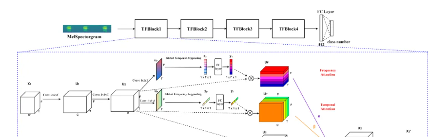
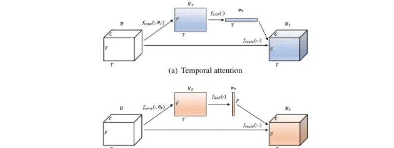

# [TF Attention Mechanism] Environment Sound Classification Based on Parallel Time-Spectral Attention [with Python Code]

This paper primarily utilizes the time-frequency image of speech signals to achieve signal classification under different noise environments. It employs TF (Time-Frequency) attention mechanism to address the issues of incomplete, inaccurate, and insufficiently detailed feature extraction by traditional CNNs. This further enhances the feature acquisition capability of the network structure and increases the recognition rate. This article is very helpful for those working on deep learning of time-frequency images.
Convolutional Neural Networks (CNN) are one of the best neural network architectures for environmental sound classification. Recently, temporal attention mechanisms have been incorporated into CNNs to capture useful information from relevant time frames in audio classification, especially for weakly labeled data that do not apply to the start and offset times of sound events. However, in these methods, there is no explicit exploitation of inherent spectral characteristics and variations when obtaining deep features. In this paper, we propose a novel parallel time-spectral attention mechanism for CNN learning discriminative sound representations by capturing the importance of different time frames and bands to enhance both time and spectral features. The parallel branches are constructed to allow separate application of time and spectral attention, thus mitigating interference from segments in the absence of sound events. Experiments on three Environmental Sound Classification (ESC) datasets and two Acoustic Scenario Classification (ASC) datasets demonstrate that the proposed method not only improves classification performance but also exhibits good robustness against noise.
Index Terms: Environmental sound classification, Convolutional Neural Networks, Attention Mechanism, Sound Events
\n        \n  
1. Introduction
Environmental Sound Classification (ESC) is an important research area in human-computer interaction, aiming to classify the environment through environmental sounds. It has various potential applications, such as audio surveillance [1] and intelligent room monitoring [2]. Due to the dynamic and unstructured nature of acoustic environments, this presents a practical challenge for designing appropriate features for ESC. In many existing methods for ESC, features are typically designed based on prior knowledge of the acoustic environment, and then classifiers are trained using these features to obtain the probability of each environmental sound signal's category.
In these methods, due to the increase in training data volume and the availability of data augmentation techniques, deep learning has been widely used for ESC. Methods based on Convolutional Neural Networks (CNN) [3-8] provide state-of-the-art performance, where spectral graphs and Mel-scale frequency cepstral coefficients (MFCC) are typically used as inputs to the network. However, unlike images in visual recognition tasks, the temporal and spectral information represented by spectrograms will have different features and significance in sound recognition. Although translations of local patterns in the time domain do not significantly affect the classification of sound events, noise across different bands has a significant impact on the performance of sound classification [9]. To capture which parts of the features are more relevant to sound events, attention mechanisms have been proposed [10-17], especially for weakly labeled data where timing information about sound events is unavailable in the training data. In these methods, applying time attention [11,14] to obtain weights for combining feature vectors at different time steps, but without considering the importance of different frequency bands. Spatial attention [17] represents the importance of regions with spatial weights to the position of sound events, but ignores inherent time-frequency characteristics.
To address the aforementioned issues, we propose a parallel time-spectral attention mechanism for CNNs to learn discriminative time-frequency representations, enabling the network to be aware of various information in both temporal frames and frequency channels. Specifically, time attention is used to capture specific frames where sound events occur, and a spectral attention method is proposed to pay varying degrees of attention to different bands. The idea behind spectral attention draws inspiration from studies on frequency-selective attention filters in human primary auditory cortex [18], which show that the human brain enhances fine-grained activity patterns within the entire superior temporal gyrus to selectively listen to frequencies of interest in a scene. Moreover, the parallel structure applied in our method alleviates interference between time and spectral features, enhancing robustness by focusing on two different branches, thus preventing fragments of noisy events from affecting one single branch. The proposed method was evaluated on three benchmark datasets (ESC-10 [19], ESC-50 [19], and UrbanSound 8 k [20]), achieving state-of-the-art classification accuracies of 95.8%, 88.6%, and 88.5% respectively. Additionally, our method was applied to another audio classification task, acoustic scene classification (ASC), further improving performance.
2. This method
In this section, the methods of time-attention and spectral-attention are introduced, which enhance the features from related time frames and bands. To simultaneously obtain both time and spectral features, a parallel time-spectral attention mechanism is then introduced.
2.1 Time and Spectral Focus
CNN is widely applied in audio classification tasks, demonstrating strong capabilities in extracting high-level features from low-level features such as logarithmic Mel spectrograms. To start with an input spectrogram of size T×F×1, a convolutional layer composed of C filter banks outputs a T×F×C feature map, which is then fed into the next convolutional layer to extract translation-invariant features. In this case, the spatial regions of the feature map are treated equally, potentially containing noise or irrelevant information from sound events.

3. Experiments
Our method was evaluated on three ESC datasets (ESC-10 [19], ESC-50 [19], and UrbanSound 8 k [20]) and two ASC datasets (DCASE 2018 Task 1A dataset [21] and DCASE 2019 Task 1A dataset [21]), which are commonly used for ESC and ASC tasks. Logarithmic Mel spectrograms were extracted from audio signals as the input for the network. The experimental setup and results are detailed below.
3.2. Network Architecture
We set up experiments with baseline models (CNN 10 [23]) and ten comparative models under the same experimental setup to evaluate the proposed attention mechanism.
CNN 10 consists of four convolutional blocks, each with 64, 128, 256, and 512 output channels respectively. Each block includes two convolutional layers with kernel sizes of 3 × 3, followed by downsampling, and average pooling with a size of 2 × 2. Batch normalization [24] and ReLU [25] functions are applied to all convolutional layers. Then, global pooling layers and two fully connected layers are applied, followed by softmax non-linearity for classification. [23] For more details about CNN 10. TS-CNN 10 TS-CNN 10 is our model based on CNN 10, where parallel time-spectral attention mechanisms are adopted for each convolutional block. All other settings are the same as CNN 10.
TS-CNN 10 -1, TS-CNN 10 -2, TS-CNN 10 -3, and TS-CNN 10 -4 are variations of TS-CNN 10 that apply the parallel time-spectral attention mechanism to only the first, second, third, and fourth convolutional blocks respectively. TS-CNN 10-fixed is another variant of TS-CNN 10 where the parameters α, β, and γ in (7) are fixed to the same values (α = β = γ = 0.33). T-CNN 10 and S-CNN 10 apply the temporal and spectral attention mechanisms respectively from Figures 1(a) and 1(B). Additionally, TS-CNN 10-concat and ST-CNN 10-concat apply the temporal-spectral concatenation and spectral-temporal concatenation attention mechanisms respectively from Figures 2(a) and 2(B).
Table 1: Accuracy comparison between ESC-10, ESC-50, and UrbanSound 8 k (US 8 k) datasets

## Images

<!-- PAYMENT_BLOCK -->

## Get this dataset

- Payment link (Stripe): [Buy now](https://buy.stripe.com/3cs8yP7sY87d0vu9AB)
- Payment QR code: 

<!-- /PAYMENT_BLOCK -->
